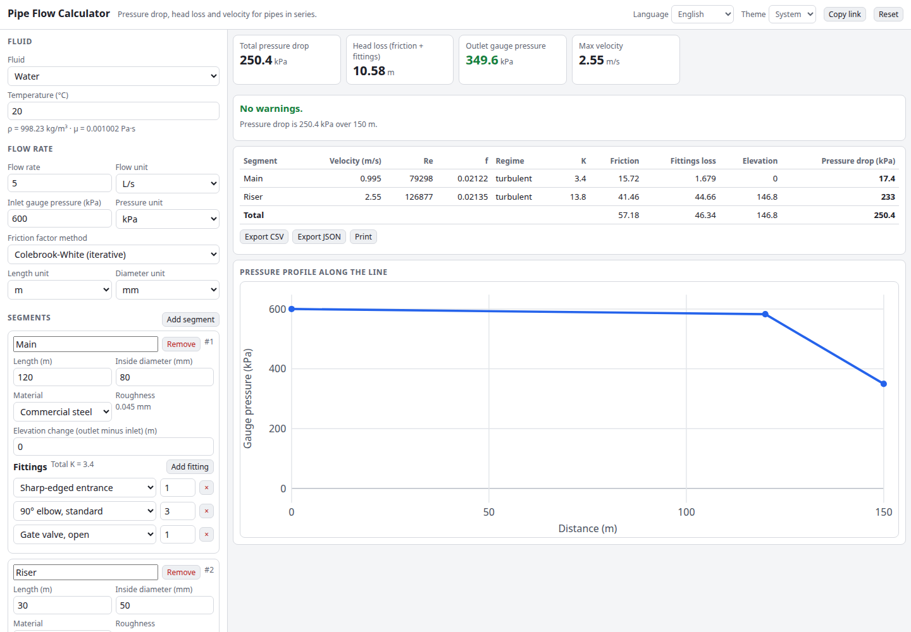

# Pipe Flow Calculator

Pressure drop, head loss and velocity for pipes in series. Enter a flow rate and a fluid (water, air, oil or your own), then describe each pipe segment: length, diameter, material, elevation change and fittings. The calculator applies the Darcy-Weisbach equation with a Colebrook-White, Swamee-Jain or Haaland friction factor and shows the pressure along the line.

**Try it: [hermes98761234.github.io/pipe-flow-calculator](https://hermes98761234.github.io/pipe-flow-calculator/)**

[](https://github.com/hermes98761234/pipe-flow-calculator/actions/workflows/deploy.yml)



## Features

- **Darcy-Weisbach** friction loss with the **Colebrook-White** (Newton iteration), **Swamee-Jain** or **Haaland** friction factor. Laminar flow uses 64/Re and the 2300 to 4000 range is blended and flagged.
- **Fluids:** water (temperature-dependent density and viscosity), air, ISO VG 32 oil, or custom density and viscosity.
- **Fittings:** typical K-values for elbows, tees, valves, entrances and exits, plus custom K.
- **Elevation** change per segment, and **multiple segments** in series with a pressure profile chart.
- **Warnings** for high velocity, transitional flow, cavitation (pressure below vacuum) and air compressibility.
- Flow in L/s, m³/h, m³/s, L/min, gpm or cfm; length in m or ft; diameter in mm or in; pressure in kPa, bar, psi or Pa.
- CSV and JSON export, print, a share link that stores the inputs, English and Ukrainian, light and dark themes. Everything runs in the browser.

## How it works

For each segment the velocity is v = Q/A and Re = ρvD/μ. The pressure drop is Δp = f (L/D) ρv²/2 + ΣK ρv²/2 + ρgΔz. The fluid is treated as incompressible, so for air the result is only reliable while the drop is small compared with the absolute pressure. Roughness values and K-values are typical textbook figures; check manufacturer data for real design work.

## Quick start

You need [Node.js](https://nodejs.org/) 22.

```bash
git clone https://github.com/hermes98761234/pipe-flow-calculator.git
cd pipe-flow-calculator
npm install
npm run dev       # http://localhost:5173
npm test          # unit tests
npm run build     # static site in dist/
```

## License

MIT
